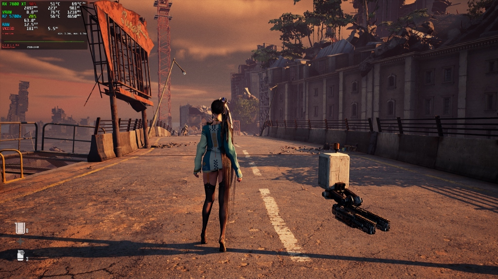

<div align="center">

# GNU-Upscaler

**A Linux & Proton-first fork of OptiScaler with 10x Multi-Frame Generation, Closed-Loop Auto-DRS, Sub-Millisecond Frame Pacing, and Native Steam Deployment**

[](https://github.com/not1cyyy/GNU-Upscaler/actions/workflows/build.yml)
[](https://github.com/not1cyyy/GNU-Upscaler/releases/tag/latest)
[](#installation)
[](#)

*Bundles **OptiScaler**, **OptiPatcher** (`OptiPatcher.asi`), **AMD FidelityFX** (FSR 4 / 3.1 / FG), and **Intel XeSS v3.0.2** (`libxess_fg.dll` + `libxell.dll`) in one automated package.*

</div>

---

<!-- Hero Showcase -->
<p align="center">
  
  <br />
  <sub><b>Stellar Blade</b> (2560×1440, VKD3D-Proton) on <b>RX 7800 XT + R7 5700X</b> — <b>181 FPS (5.5 ms)</b> with a flat frametime graph (5.3–8.7 ms)</sub>
</p>

## Why GNU-Upscaler?

Upstream OptiScaler is built primarily for Windows. Running modern upscaling and frame generation under **Wine / Proton / VKD3D-Proton** introduces coarse timer jitter, swapchain color-space crashes, `WINELOADER` Streamline blocks, and missing vendor unlocks. **GNU-Upscaler** solves those at the engine and presentation boundary while adding an entire suite of original features:

| Feature | What It Does | Where It Shines |
| :--- | :--- | :--- |
| **10x XeFG Unlock** | Patches `libxess_fg.dll` in memory (SIMD AOB) to unlock `2x`, `3x`, `4x`, `6x`, and `10x` on **any GPU** | High-refresh monitors (144Hz–360Hz+) |
| **Adaptive Dynamic FG (ADFG)** | Shared `FG_DynamicController` for XeFG, FSR-FG & DLSS-G with a `MinBaseFps` latency floor guard | Keeps input lag low in heavy combat |
| **GNU Adaptive Quality (GAQ)** | GPU-timestamp & sleep-aware PID Auto-DRS with **CPU-bound detection** & **MotionBoost** | Steam Deck, handhelds & 4K targets |
| **Front-Edge Frame Pacing** | JIT / VBlank PLL / `VK_EXT_present_timing` / `VK_GOOGLE_display_timing` + GPU completion sync | Butter-smooth frametimes under Proton |
| **FSR 4 Auto-Step-Down** | Monitors FSR 4 GPU pass time (`Fsr4MaxGpuMs`) and steps models (`FP8`, `INT8`, `INT8 Lite`) & presets | Preventing GPU-bound stutters |
| **Zero-Copy & Tile-Skip HUDFix** | `ZeroCopyHudless` + 16×16 super-tile `HudCopyTileSkip` + `PackedBuffers` (`R11G11B10F`) | Slashes Frame Gen overhead & VRAM bandwidth |
| **Integrated OptiPatcher** | SIMD (`memchr`) pattern scanner, generic UE unlock, `patches.ini`, & Nixxes `WINELOADER` bypass | Native AMD/Intel shader paths without spoofing |
| **Modern `GnuUi` Overlay** | 6-tab redesigned ImGui UI with **One-Click Presets** & live pipeline telemetry | Instant tuning with `Insert` |

---

## Contents

- [Installation](#installation)
- [Core Features](#core-features)
  - [Multi-Frame Generation up to 10x & Adaptive Dynamic FG](#multi-frame-generation-up-to-10x--adaptive-dynamic-fg)
  - [GNU Adaptive Quality (GAQ Auto-DRS)](#gnu-adaptive-quality-gaq-auto-drs)
  - [Frame Pacing, Latency & Vulkan Parity](#frame-pacing-latency--vulkan-parity)
  - [FSR 4 Model Management & Auto-Step-Down](#fsr-4-model-management--auto-step-down)
  - [Zero-Copy HUDFix, DX12 & HDR Pipeline](#zero-copy-hudfix-dx12--hdr-pipeline)
  - [OptiPatcher & Game-Specific Linux Fixes](#optipatcher--game-specific-linux-fixes)
  - [Anti-Cheat Safety Guard](#anti-cheat-safety-guard)
- [In-Game Overlay (`GnuUi`) & Hotkeys](#in-game-overlay-gnuui--hotkeys)
- [Configuration Reference (`OptiScaler.ini`)](#configuration-reference-optiscalerini)
- [Recommended Game Engine Tweaks](#recommended-game-engine-tweaks)
- [Building from Source](#building-from-source)

---

## Installation

### One-Line Linux Installer

Run the installer directly without cloning the repository. It downloads the latest CI release from GitHub, caches it in `~/.cache/gnu-upscaler/`, auto-discovers your Steam libraries (native & Flatpak), resolves nested binary folders (e.g., `*/Binaries/Win64`, `bin/x64`, `Client/WindowsNoEditor/HT/Binaries/Win64`), and can automatically inject `WINEDLLOVERRIDES` into Steam's `localconfig.vdf` (creating a `.bak` backup first).

```bash
bash <(curl -fsSL https://raw.githubusercontent.com/not1cyyy/GNU-Upscaler/main/install.sh)
```

Or pass flags and a game path directly:

```bash
# FSR 4 + Frame Generation with automatic Steam launch option injection
bash <(curl -fsSL https://raw.githubusercontent.com/not1cyyy/GNU-Upscaler/main/install.sh) --fsr4 --fg --auto-steam "/path/to/game"
```

### Common Installer Recipes

```bash
# Universal Frame Generation (OptiFG) for games without native FG toggles
./install.sh --optifg "/path/to/Stellar Blade"

# XeFG 6x Multi-Frame Generation + GAQ Auto-DRS
./install.sh --xefg --mfg=6x --gaq "/path/to/game"

# Fetch FSR 4 INT8 / FP8 extra model variants into custom/ (recommended, 'all', or tag filter)
./install.sh --fsr4 --fetch-extras "/path/to/game"

# Use an alternate proxy DLL (default: dxgi.dll)
./install.sh --proxy=version.dll "/path/to/game"

# Force re-download of the latest CI build
./install.sh --update "/path/to/game"

# Cleanly remove GNU-Upscaler and Steam launch overrides from a game
./install.sh --uninstall "/path/to/game"
```

<details>
<summary><b>All <code>install.sh</code> CLI Flags &amp; Supported Proxy DLLs</b></summary>

| Flag | Description |
| :--- | :--- |
| `--proxy=<name>` | Proxy DLL name: `dxgi.dll` (default), `winmm.dll`, `version.dll`, `d3d12.dll`, `dbghelp.dll`, `wininet.dll`, `winhttp.dll` |
| `--fsr4` / `--fsr3` / `--xess` / `--dlss` | Pre-configure `OptiScaler.ini` upscaler backend across DX12, DX11, and Vulkan |
| `--fg` | Enable Frame Generation (`FGOutput=auto`, `FGInput=auto`) |
| `--optifg` | Enable universal upscaler-driven Frame Generation (`FGInput=upscaler`, `HUDFix=true`) |
| `--xefg` | Set Frame Generation output to Intel XeFG |
| `--mfg=<mult>` | Enable XeFG Multi-Frame Generation (`2x`, `3x`, `4x`, `6x`, `10x`) |
| `--gaq` | Enable GNU Adaptive Quality (`[GAQ] Enabled=true`) |
| `--fetch-extras[=filter]` | Download FSR 4 INT8 & FP8 variants from `Optiscaler-Client` into `custom/` (`recommended`, `all`, or tag substring) |
| `--auto-steam` | Automatically inject `WINEDLLOVERRIDES` into Steam `localconfig.vdf` (with `.bak` backup) |
| `-u`, `--update` | Force re-check and download of the latest GitHub release |
| `--uninstall` | Remove proxy DLLs, companion DLLs, `OptiPatcher.asi`, and Steam launch overrides |

</details>

### Steam Launch Option

If you don't use `--auto-steam` (or decline the interactive prompt), add the DLL override in Steam game properties:

```text
WINEDLLOVERRIDES="dxgi=n,b" %command%
```

> **Tip:** Replace `dxgi` if you chose another proxy (e.g. `version=n,b`). For lowest frame-pacing jitter under Proton, avoid stacking external limiters like `DXVK_FRAME_RATE` or MangoHud `fps_limit` on top of GNU-Upscaler's pacer, and consider `PROTON_USE_NTSYNC=1`.

---

## Core Features

### Multi-Frame Generation up to 10x & Adaptive Dynamic FG

- **Universal 10x XeFG Unlock (`XeFG_Unlock.h`)**: Upstream Intel XeFG caps interpolation at 4x and restricts it to Intel Arc GPUs. GNU-Upscaler dynamically scans `libxess_fg.dll` in memory using AOB patterns and unlocks **`2x`, `3x`, `4x`, `6x`, and `10x`** (`InterpolationCount` `1` through `9`) on AMD, Intel, and NVIDIA GPUs—no external ASI loader required.
- **3x+ Swapchain & Sub-Frame Stagger**: Automatically scales VKD3D swapchain `minImageCount` for 3x+ XeFG, uses an open-loop Virtual VSync clock / DXGI stagger (`FramerateLimitFgSubframeMode`), and bounds DXGI latency waitable waits (`PaceOnSwapchain=true`, `MaxWaitMs=2`).
- **Shared Dynamic Frame Generation (`FG_DynamicController`)**:
  - Works across **XeFG** (`DynamicMFG`), **FSR-FG** (DX12 & Vulkan), and **DLSS-G** (`DynamicFG`).
  - Modulates between multipliers and `2X <-> 1X` passthrough with hysteresis around `DynamicTargetFps` (or your refresh rate / FPS cap).
  - **Latency Floor Guard (`MinBaseFps`, default `45.0`)**: Automatically drops Frame Generation down when native base rendering dips below your floor so controls never feel sluggish.
  - **Camera Cut Detection**: Detects sharp camera transitions to reset interpolation history cleanly without smearing.

---

### GNU Adaptive Quality (GAQ Auto-DRS)

A closed-loop **PID Dynamic Resolution Scaling** engine (`GaqController.h`) that works with **every upscaler input** even when the game has no native DRS:

- **GPU-Timestamp & Sleep-Aware**: Reads actual active GPU/present frametimes (ignoring limiter/VSync sleep) and adjusts render scale in smooth `0.05` steps (`dwellMs = 500ms`) between `MinRatio` and `MaxRatio`.
- **CPU-Bound Detection**: Automatically detects when the game is CPU-bottlenecked (`gaqCpuBound`) so it stops needlessly lowering resolution when GPU headroom isn't the problem.
- **MotionBoost (`MotionBoost = 0.20`)**: Temporarily increases the upscale ratio during rapid camera/mouse turns—where extra pixels are hardest to notice—and smoothly recovers quality when the camera settles.

---

### Frame Pacing, Latency & Vulkan Parity

GNU-Upscaler replaces coarse Wine/Windows timer sleeps with a precision frame-pacing stack across **DX12** and **Vulkan**:

- **Three Limiter Modes (`FramerateLimitMode`)**:
  - `0` — **Front-Edge JIT** *(default)*: Sleeps post-present minus measured CPU work lead, then trims pre-present.
  - `1` — **Front-Edge Sync**: RTSS-style pre-present wait aligned to VBlank/compositor phase (`FramerateLimitSyncMarginMs = 0.6ms`).
  - `2` — **Back-Edge**: Drift-free post-present sleep.
- **Vulkan Presentation & Sync (`VulkanFrameSync`)**:
  - Supports **`VK_EXT_present_timing`** with adaptive spin-tail pacing.
  - Schedules `desiredPresentTime` via **`VK_GOOGLE_display_timing`** when clock offsets are calibrated.
  - Enforces in-flight present caps via **`VK_KHR_present_wait`** (`FramerateLimitMaxInFlight`, bypassed cleanly during active FG).
  - Calibrated **GPU completion sync** (`FramerateLimitGpuSync`) and **MMCSS thread priority boost** (`FramerateLimitPriorityBoost`).
- **Full Vulkan Shader Parity**: Precompiled SPIR-V compute pipelines for Auto Exposure (`AE_Vk`), Bias (`Bias_Vk`), HUDless Compare Compute (`HCC_Shader_Vk`), Format Transfer, Output Scaling, and RCAS.
- **Low-Latency Ecosystem**: Integrates **NVIDIA Reflex**, **AMD Anti-Lag 2** (DX12) & **Anti-Lag VK**, **Intel XeLL** (`libxell.dll` with `xefg_xell` FPS cap sync), and **LatencyFleX**.

---

### FSR 4 Model Management & Auto-Step-Down

- **Multi-Model Selection (`Fsr4Model`)**: Supports `FP8`, `INT8`, `INT8 RDNA2`, and `INT8 Lite` providers (including custom INT8/FP8 builds fetched via `--fetch-extras`).
- **GPU Time Budget (`Fsr4MaxGpuMs`)**: Set a millisecond budget for the FSR 4 upscaling pass (e.g. `2.5` ms). If FSR 4 exceeds the budget, GNU-Upscaler automatically steps down to a lighter FSR 4 preset/model and steps back up when headroom returns.

---

### Zero-Copy HUDFix, DX12 & HDR Pipeline

- **`ZeroCopyHudless`**: Passes matching-format, swapchain-sized HUDless render targets directly to Frame Generation without a full-screen GPU copy.
- **`HudCopyTileSkip`** *(default `true`)*: Uses a 16×16 super-tile GPU activity mask in `HudCopy` to skip static non-HUD screen regions and identical-pixel writes.
- **`PackedBuffers`** *(default `true`)*: Allocates 32-bit `DXGI_FORMAT_R11G11B10_FLOAT` intermediate buffers instead of 64-bit `RGBA16F` when alpha isn't needed.
- **`CmdListFastPath` & `UseShards`**: Lock-free fast bypass for D3D12 command list hooks when tracking is inactive, plus sharded mutexes for multithreaded resource tracking.
- **XeFG HUD Mask Support & Ray Reconstruction Spoofing**: Isolates HUD masks inside XeFG to eliminate UI ghosting at 6x/10x, and exposes DLSS 3.5 Ray Reconstruction on non-NVIDIA GPUs.
- **VKD3D-Proton & HDR Fixes**:
  - Resolves Unreal Engine `SetColorSpace1` crashes by configuring 10-bit `DXGI_FORMAT_R10G10B10A2_UNORM` swapchains.
  - Auto-detects **HDR10 PQ** color transfer curves and fixes output scaling compute dispatch dimensions.
  - **RCAS Highlight Preservation**: Prevents specular highlight clipping on HDR displays.
  - **Auto-Detect Inverted Depth**: Inspects projection matrices at runtime to detect inverted Z-buffers.

---

### OptiPatcher & Game-Specific Linux Fixes

Many games hide DLSS, Reflex, or Frame Generation toggles when an NVIDIA GPU isn't detected. Traditional DXGI spoofing (`0x10DE`) often crashes Unreal Engine under Proton (`D3D12 not supported`) or forces slow NVIDIA-specific shader paths on Mesa/RADV.

**OptiPatcher** (`plugins/OptiPatcher.asi`) patches vendor checks directly in memory so games stay on native AMD/Intel driver paths:

- **SIMD Pattern Scanner**: Uses hardware-accelerated `memchr` (AVX2/SSE2) scanning across executable sections.
- **Generic Unreal Engine Scanner**: Automatically unlocks unlisted UE4/UE5 titles.
- **External `patches.ini`**: Add custom AOB offsets in `plugins/patches.ini` without recompiling.
- **Ratchet & Clank: Rift Apart (Nixxes) Linux Fix**: Unlocks both DLSS and Reflex vendor checks (supporting legacy and `v1.727.0.0+` binaries) **and** bypasses Nixxes' `WINELOADER` environment check that otherwise disables Streamline under Wine/Proton.

---

### Anti-Cheat Safety Guard

Monitors running processes for active anti-cheat runtimes (such as Easy Anti-Cheat). If a protected multiplayer session is detected, GNU-Upscaler aborts DLL hooks to prevent account penalties.

---

## In-Game Overlay (`GnuUi`) & Hotkeys

GNU-Upscaler features a redesigned, scalable ImGui overlay (`GnuUi`) with filled-track sliders, segmented toggles, inline hover advice, and 6 organized tabs:

1. **Quick Start** — Live **Pipeline Status** (upscaler, scale factor, active FG multiplier, Reflex markers), **One-Click Presets** (`Quality`, `Balanced`, `Performance`, `Battery Saver`, `Native AA`), and Quick Controls.
2. **Upscaling** — Backend selection, FSR 4 model/budget, upscale ratio, output scaling, and input settings.
3. **Frame Gen** — Output backend (FSR-FG / XeFG / DLSS-G), Multi-Frame Gen multiplier (`2x`–`10x`), Dynamic FG, Frame Limiter mode, Low Latency, and VSync.
4. **Image** — Sharpness (RCAS), API & texture tweaks, init flags, and magnifier.
5. **Interface** — Performance/FPS telemetry overlay, keybinds, UI scale, and themes.
6. **Advanced** — Game quirks, DX12/Vulkan engine tweaks, and logging.

| Default Key | Action |
| :--- | :--- |
| **`Insert`** | Open / close the GNU-Upscaler overlay |
| **`End`** | Quick-toggle Frame Generation |
| **`Page Up`** | Toggle FPS & frametime telemetry HUD |
| **`Page Down`** | Cycle FPS telemetry overlay detail |

---

## Configuration Reference (`OptiScaler.ini`)

`install.sh` generates `OptiScaler.ini` next to your proxy DLL and preserves it on updates. Key GNU-Upscaler sections:

```ini
[Upscalers]
; auto, ffx (FSR 4 / 3.1), xess, dlss, fsr22
Dx12Upscaler=auto

[FSR]
; auto (FSR 4 on supported GPUs), 1 (forces FSR 3.1)
UpscalerIndex=auto
; 0=FP8, 1=INT8, 2=INT8 RDNA2, 3=INT8 Lite
Fsr4Model=auto
; GPU time budget in ms before auto-stepping down FSR 4 model/preset (0 = disabled)
Fsr4MaxGpuMs=auto

[FrameGen]
Enabled=true
; auto, fsrfg, xefg, dlssg
FGOutput=auto
; auto, dlssg (Streamline), upscaler (OptiFG), fsrfg
FGInput=auto
; Dynamic FG 2X <-> 1X modulation for FSR-FG & DLSS-G
DynamicFG=auto
DynamicTargetFps=auto
MinBaseFps=45.0

[XeFG]
; 1=2x, 2=3x, 3=4x, 5=6x, 9=10x
InterpolationCount=auto
DynamicMFG=false
PaceOnSwapchain=true
MaxWaitMs=2

[Framerate]
FramerateLimit=auto
; 0=Front-Edge JIT, 1=Front-Edge Sync (VBlank PLL), 2=Back-Edge
FramerateLimitMode=0
; 0=Off, 1=Auto GPU flush, 2=Strict RTSS SyncFlush
FramerateLimitGpuSync=1
FramerateLimitFgSubframeMode=1

[GAQ]
Enabled=false
TargetFps=60.0
MinRatio=1.0
MaxRatio=2.5
MotionBoost=0.20

[DX12]
PackedBuffers=true
CmdListFastPath=true

[HUDFix]
ZeroCopyHudless=false
HudCopyTileSkip=true
UseShards=true

[Plugins]
LoadAsiPlugins=true
```

---

## Recommended Game Engine Tweaks

### Unreal Engine (`Engine.ini`)

Unreal Engine titles sometimes dilate motion vectors before passing them to upscalers, which can cause ghosting with XeFG or Output Scaling. Disable dilation in the game's `Engine.ini`:

```ini
[SystemSettings]
r.NGX.DLSS.DilateMotionVectors=0
r.Streamline.DilateMotionVectors=0
```

If an Unreal Engine game crashes when using FSR2 inputs in DX12 mode, add:

```ini
[SystemSettings]
r.FidelityFX.FSR2.UseNativeDX12=1
```

---

## Building from Source

Automated builds compile on Windows via GitHub Actions (`.github/workflows/build.yml`) using Visual Studio 2022 (`Release | x64`) and publish `GNU-Upscaler-latest.zip` to the `latest` release.

```cmd
:: Build OptiScaler
cd OptiScaler
msbuild /m /p:Configuration=Release /p:Platform=x64 OptiScaler.sln

:: Build OptiPatcher
cd ..\OptiPatcher
msbuild /m /p:Configuration=Release /p:Platform=x64 OptiPatcher.sln
```

---

<div align="center">
  <sub>Built on <a href="https://github.com/cdozdil/OptiScaler">OptiScaler</a> • Tailored for Linux, Proton &amp; SteamOS</sub>
</div>
